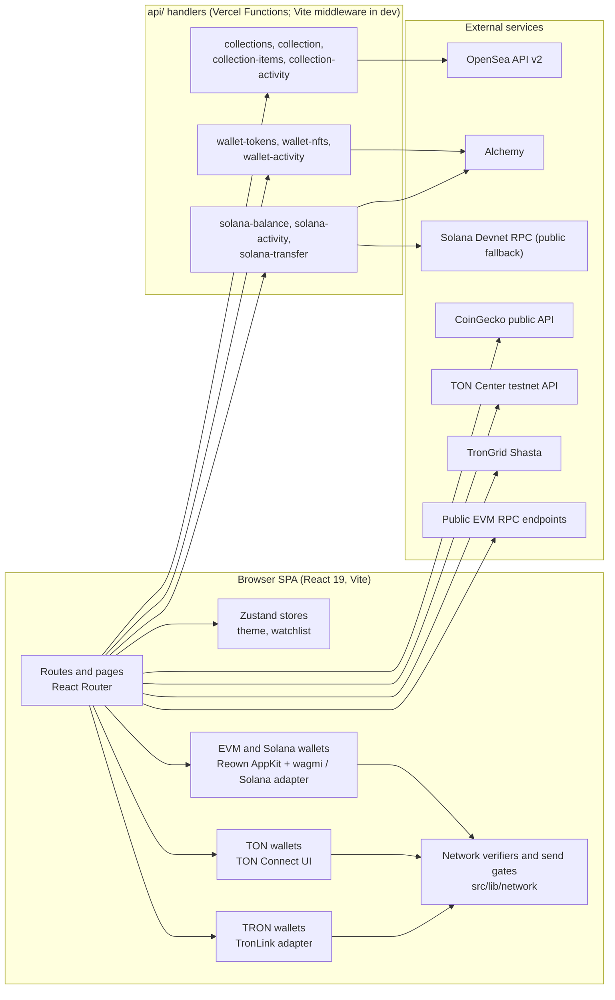

<div align="center">

# NEXORA

**Multi-chain discovery and a testnet wallet workspace for EVM, Solana, TON and TRON.**

Explore tokens and NFT collections, connect wallets across four chain families, and test native-asset transfers on public testnets, all from one React interface.

<br />


[Overview](#overview) · [Status](#implementation-status) · [Architecture](#architecture) · [Networks](#network-support) · [Getting Started](#getting-started) · [Deployment](#deployment)

</div>

> **Live demo:** none verified. No deployment URL is recorded in the repository.
> **Repository URL:** not recorded in the files audited for this README.

---

## Table of Contents

- [Overview](#overview)
- [Implementation Status](#implementation-status)
- [Screenshots](#screenshots)
- [Architecture](#architecture)
- [Network Support](#network-support)
- [Technology Stack](#technology-stack)
- [Getting Started](#getting-started)
- [Environment Variables](#environment-variables)
- [API and Data Integrations](#api-and-data-integrations)
- [Project Structure](#project-structure)
- [Testing and Quality](#testing-and-quality)
- [Deployment](#deployment)
- [Security and Responsible Use](#security-and-responsible-use)
- [Roadmap](#roadmap)
- [Contributing](#contributing)
- [License](#license)
- [Acknowledgements](#acknowledgements)

---

## Overview

NEXORA is a single-page web app (React, Vite, TypeScript) that combines two things:

1. **A discovery layer** for tokens and NFT collections: market tables, token detail pages, collection directories and detail pages, a watchlist, and several editorial and workspace pages.
2. **A wallet workspace** (`/wallet`) that connects wallets on four chain families and reads balances, tokens, NFTs and activity. It can also send the native asset on one test network per family.

**Problem it addresses.** Multi-chain tooling usually means one app per ecosystem. NEXORA puts discovery and test-network wallet flows for several ecosystems behind one interface and one set of safety checks.

**Who it is for.** Developers and testers exploring multi-chain wallet UX, and contributors who want a TypeScript codebase with strict network guards and extensive unit tests around Web3 logic.

**Differentiators found in the code**

- Every supported chain family has an explicit network verifier. A wallet on the wrong network is reported as a mismatch and is never silently treated as the supported one.
- Send flows pass a gate that refuses non-test networks before anything is built or signed.
- Provider API keys stay server-side. Browser code only calls NEXORA's own `/api/*` proxies, or public endpoints where no key is needed.
- Data states are explicit (live, stale, empty, unavailable, unsupported) so that a failed read is never shown as a zero balance.

**Status.** Pre-release. `package.json` has `"private": true` and version `0.0.0`, and the package name is `nexora-cursor`.

---

## Implementation Status

Legend: **Implemented** = code and tests exist for the behaviour. **Testnet only** = restricted by guards to a test network. **Demo** = local sample data or simulation, no live backend. **Not supported** = absent or explicitly refused.

| Area | Status | Notes |
|---|---|---|
| Wallet connection, EVM and Solana | Implemented, testnet target | Reown AppKit with wagmi (EVM) and the Reown Solana adapter. Needs `VITE_REOWN_PROJECT_ID`. |
| Wallet connection, TON | Implemented, testnet only | TON Connect UI. Needs a valid TON Connect manifest. |
| Wallet connection, TRON | Implemented, testnet only | TronLink adapter only. |
| Native balances | Implemented, testnet only | Sepolia ETH, Solana Devnet SOL, TON Testnet, TRON Shasta. |
| ERC-20 token balances | Implemented | Through `/api/wallet-tokens` (Alchemy). Needs `ALCHEMY_API_KEY`. |
| Wallet NFTs | Implemented, EVM only | Through `/api/wallet-nfts` (Alchemy). Chain list excludes Linea and Sepolia. Solana NFTs not served. |
| Wallet activity | Implemented | EVM through `/api/wallet-activity`; Solana Devnet through `/api/solana-activity`. |
| Native transfers | Implemented, testnet only | ETH on Sepolia, SOL on Devnet, TON on Testnet, TRX on Shasta. |
| Transaction tracking | Implemented | Solana signature status via `/api/solana-transfer`; TON confirmation via TON Center; TRON status via TronGrid (Shasta). |
| Token market data | Implemented | CoinGecko public API, called from the browser. Tokens `NEX` and `RND` are fictional and have no live market. |
| NFT collections directory and detail | Implemented | Live data from OpenSea API v2 through server proxies. Needs `OPENSEA_API_KEY`. Demo catalogue records exist and are labelled as demo. |
| Watchlist | Implemented (local) | Persisted in browser storage (`nexora-watchlist`). |
| Network switching | Not performed by NEXORA | The app detects the wallet's network and asks the user to switch inside the wallet. |
| Swap | Demo | "Exchange preview" with a simulated confirmation. The UI states that no tokens move. |
| Rewards, Assistant, Profile, Drops, Ecosystems, Tools | Demo | Seeded local data. The assistant gives scripted replies, not a live AI service. Profile is local demo state. |
| Mainnet transfers | Not supported | Refused by guards for EVM and Solana. TON and TRON flows target testnet only. |
| Marketplace trading (buy, sell, bid) | Not found | No purchase flow was found in the source. |

---

## Screenshots

No screenshots or `public/` assets were present in the files audited for this README, so no images are embedded. Nothing below is a real capture.

The repository includes a Playwright script, `capture-screenshots.mjs`, that captures the `/wallet` page at five viewport widths (1440, 1280, 1024, 768, 390) as `screenshot-<width>.png`. It expects the app at `http://localhost:5174`.

```bash
npm run dev -- --port 5174
# in a second terminal
npx playwright install chromium
node capture-screenshots.mjs
```

Suggested structure once real captures exist (add the files first, then uncomment):

```markdown
<!-- Discover       -> docs/screenshots/discover.png     (alt: "NEXORA Discover page") -->
<!-- Collections    -> docs/screenshots/collections.png  (alt: "NEXORA NFT collections directory") -->
<!-- Tokens         -> docs/screenshots/tokens.png       (alt: "NEXORA token market table") -->
<!-- Wallet         -> docs/screenshots/wallet.png       (alt: "NEXORA multi-chain wallet dashboard") -->
```

---

## Architecture

NEXORA is a client-rendered SPA. Chain-family wallet providers live in the browser. A small set of serverless-style handlers in `api/` holds provider keys and proxies read-only data and one relay endpoint. In development, the same handlers are mounted by Vite middleware, so `vercel dev` is not required.



**Notable decisions**

- **Keys stay on the server.** `OPENSEA_API_KEY` and `ALCHEMY_API_KEY` have no `VITE_` prefix and are used only inside `api/` handlers. The handlers are not open relays: fixed upstream paths, allow-listed chain IDs, validated addresses and cursors.
- **One registry for network facts.** `src/lib/wallet/network-config.ts` holds chain IDs, explorers and provider slugs. Other modules derive from it, and tests check that they agree.
- **Pure logic is separated from React.** Amount parsing, gates, verifiers and transfer flows are plain TypeScript with unit tests. Money values use `bigint`, not floats.
- **Public endpoints with fallback.** EVM reads try an optional configured RPC first, then public endpoints, and every response is checked against the requested chain ID. Solana reads try Alchemy Devnet, then the public Devnet RPC, and verify the cluster's genesis hash.
- **Lazy-loaded routes.** Pages are code-split with `React.lazy`.

---

## Network Support

The Wallet page works on **one test network per ecosystem**. A wallet on any other network is shown as a mismatch, and NEXORA will not switch the network for you.

| Network | Chain ID / identifier | Environment | Connection | Balance | Transfer | Notes |
|---|---|---|---|---|---|---|
| Ethereum Sepolia | `11155111` | Testnet | AppKit + wagmi | Yes | Native ETH | Token balances and activity via Alchemy proxy. NFTs not listed for Sepolia. |
| Solana Devnet | cluster `devnet` | Testnet | AppKit Solana adapter | Yes (SOL) | Native SOL | Wallet signs; NEXORA relays the signed transaction through `/api/solana-transfer`. SPL tokens and Solana NFTs not served. |
| TON Testnet | `-3` | Testnet | TON Connect UI | Yes | Native TON | Transfer amount capped at 1,000 TON per request in code. Request validity 300 seconds. |
| TRON Shasta | `0x94a9059e` | Testnet | TronLink adapter | Yes | Native TRX | TronLink only. Detected TRON Mainnet (`0x2b6653dc`) and Nile (`0xcd8690dc`) are reported as mismatches. |
| Ethereum | `1` | Mainnet | Selectable in AppKit | Not on Wallet page | Refused | Wallet page reports a mismatch. Configured in the shared data layer. |
| Base | `8453` | Mainnet | Selectable in AppKit | Not on Wallet page | Refused | Same as above. |
| Arbitrum One | `42161` | Mainnet | Selectable in AppKit | Not on Wallet page | Refused | Same as above. |
| Linea | `59144` | Mainnet | Selectable in AppKit | Not on Wallet page | Refused | Not in the NFT or activity provider tables. |
| Optimism | `10` | Mainnet | Selectable in AppKit | Not on Wallet page | Refused | Same as above. |
| Polygon PoS | `137` | Mainnet | Selectable in AppKit | Not on Wallet page | Refused | Same as above. |

**How wallets connect**

- **EVM and Solana:** `src/lib/wallet/config.ts` builds Reown AppKit with a wagmi adapter (EVM networks: Ethereum, Base, Arbitrum, Optimism, Polygon, Linea, Sepolia) and a Solana adapter offering only Devnet. The default network is Sepolia. AppKit's own email, social login, swaps, on-ramp, send, receive, history and analytics features are turned off.
- **TON:** `@tonconnect/ui-react` with a manifest URL, by default `<origin>/tonconnect-manifest.json`.
- **TRON:** `@tronweb3/tronwallet-adapter-tronlink`. If TronLink is missing, the UI says so.

**Where data comes from**

- **EVM native balance and general chain data:** JSON-RPC over an optional configured endpoint or public endpoints.
- **ERC-20, NFTs, EVM activity:** Alchemy through NEXORA's proxies.
- **Solana Devnet:** Alchemy Devnet host when a key is set, otherwise the public Devnet RPC.
- **TON Testnet:** TON Center v2 (overridable with `VITE_TON_TESTNET_API_URL`).
- **TRON Shasta:** TronGrid Shasta, called directly from the browser.

**Known limitations**

- Mainnet EVM chains are configured in the data layer, but which non-wallet pages read from them was not verified.
- No universal wallet compatibility is claimed. Compatibility depends on AppKit, TON Connect and TronLink.
- No cross-chain transfers or bridging exist.

---

## Technology Stack

Only dependencies imported by the source are listed.

| Group | Technologies |
|---|---|
| Core application | React 19, TypeScript 6, Vite 8, React Router 7 |
| UI and styling | Tailwind CSS 4 (`@tailwindcss/vite`), Radix UI primitives, `class-variance-authority`, `clsx`, `tailwind-merge`, `lucide-react`, `motion` (animation), Three.js with `@react-three/fiber` and `drei`, `simplex-noise` (hero visuals), Recharts (charts) |
| State and data fetching | Zustand with persistence, TanStack Query (wallet provider) |
| EVM | Reown AppKit, `@reown/appkit-adapter-wagmi`, wagmi 3, viem 2 |
| Solana | `@reown/appkit-adapter-solana`, `@solana/web3.js` |
| TON | `@tonconnect/ui-react`, `@ton/core`, `buffer` |
| TRON | `@tronweb3/tronwallet-adapter-tronlink`, `-abstract-adapter`, `-react-hooks` |
| APIs and data services | OpenSea API v2, Alchemy, CoinGecko, TON Center, TronGrid, public Solana and EVM RPC |
| Testing and quality | Node built-in test runner (`node --test`) on TypeScript files, `tsc` type checks, oxlint, Playwright (screenshot script) |
| Deployment | Vercel (`vercel.json`, Vercel Functions in `api/`) |

---

## Getting Started

### Prerequisites

- **Node.js and npm.** The repo has a `package-lock.json` (use npm) and no `engines` field. The test script runs `.ts` files directly with `node --test`, which needs a Node version with TypeScript type-stripping. Node 22.22.2 was used for the audit of the unit tests; other versions are unverified.
- A free [Reown](https://dashboard.reown.com) project ID for EVM and Solana wallet connections.
- Optional provider keys for live data: OpenSea and Alchemy (see [Environment Variables](#environment-variables)).

### Install and run

```bash
git clone <repository-url>
cd <repository-folder>
npm install
```

Create a local environment file (it is git-ignored):

```bash
# Bash / macOS / Linux
cp .env.example .env.local
```

```powershell
# PowerShell
Copy-Item .env.example .env.local
```

Edit `.env.local`, uncomment the variables you need and fill in your own values. Then:

```bash
npm run dev       # development server (also serves the /api handlers)
npm run build     # type-check, then production build
npm run preview   # preview the production build locally
```

### Quality commands

| Command | What it runs |
|---|---|
| `npm run lint` | `oxlint` |
| `npm run typecheck` | `tsc -b && tsc -p tsconfig.api.json` |
| `npm test` | `node --test` over the unit-test globs in `package.json` |
| `npm run test:types` | `tsc -p tsconfig.test.json` |
| `npm run predeploy` | typecheck, lint, tests, test type-check, then build |

---

## Environment Variables

Names are taken from `.env.example` and the source. **Every `VITE_*` value is compiled into the public bundle. Never put a secret in one.** Server-only variables have no prefix.

| Variable | Purpose | Required | Applies to | Placeholder |
|---|---|---|---|---|
| `VITE_REOWN_PROJECT_ID` | Reown AppKit project ID (public identifier). Without it the app runs but EVM and Solana connection is disabled and the UI explains what is missing. | Required for EVM/Solana wallets | Browser | `your-reown-project-id` |
| `VITE_RPC_URL_<chainId>` | Preferred JSON-RPC URL for a chain. IDs in `.env.example`: `1`, `8453`, `42161`, `59144`, `137`, `10`, `11155111`. Must be `https` (`http` only for localhost), no embedded credentials. | Optional | Browser | `https://rpc.example.org` |
| `VITE_COLLECTIONS_API_URL` | Use a different collections endpoint than `/api/collections`. | Optional | Browser | `https://collections.example.org/api/collections` |
| `VITE_MARKET_API_BASE_URL` | Base URL of your own proxy or mirror of CoinGecko's `/api/v3`. Read by the code but not listed in `.env.example`. | Optional | Browser | `https://market-proxy.example.org/api/v3` |
| `VITE_TONCONNECT_MANIFEST_URL` | Absolute URL of the TON Connect manifest. Default: `<origin>/tonconnect-manifest.json`. `https` required (`http` only for localhost). | Optional | Browser | `https://your-domain.example/tonconnect-manifest.json` |
| `VITE_TON_TESTNET_API_URL` | TON Center v2-compatible testnet API base URL. Default: `https://testnet.toncenter.com/api/v2`. No keys or query strings. | Optional | Browser | `https://ton-proxy.example.org/api/v2` |
| `OPENSEA_API_KEY` | OpenSea API key for the collections proxies. Sent upstream only in the `x-api-key` header. | Required for live collections | Server (dev middleware and Vercel) | `your-opensea-key` |
| `ALCHEMY_API_KEY` | Alchemy key for token, NFT, activity and Solana handlers. For Solana it is optional: the public Devnet RPC is used as a fallback. Enable the networks you need in the Alchemy dashboard. | Required for ERC-20, NFT and EVM activity | Server (dev middleware and Vercel) | `your-alchemy-key` |

Notes

- `.gitignore` excludes `.env` and `.env.*` but keeps `.env.example`.
- The code does not read `SOLANA_RPC_URL`. Remove it from local env files if present.
- If a keyed TON endpoint is needed, use a server-side proxy instead of putting a key in `VITE_TON_TESTNET_API_URL`.

---

## API and Data Integrations

### Internal routes (`api/`)

All routes are read-only except the Solana relay. Handlers are served as Vercel Functions in production and mounted by `vite.config.ts` for `npm run dev`. Files prefixed with `_` are shared helpers and are not exposed as routes.

| Route | Method | Purpose | Upstream | Key |
|---|---|---|---|---|
| `/api/collections` | GET | Ranked collections list with stats | OpenSea | `OPENSEA_API_KEY` |
| `/api/collection?slug=` | GET | One collection: identity, stats, traits, sample items (cached 5 min per slug) | OpenSea | `OPENSEA_API_KEY` |
| `/api/collection-items` | GET | Paged NFTs, plus best-effort listing and sale prices | OpenSea | `OPENSEA_API_KEY` |
| `/api/collection-activity` | GET | Recent sale, listing or transfer events | OpenSea | `OPENSEA_API_KEY` |
| `/api/wallet-tokens` | GET | ERC-20 balances and metadata | Alchemy Token API | `ALCHEMY_API_KEY` |
| `/api/wallet-nfts` | GET | NFTs owned by an EVM address | Alchemy NFT API v3 | `ALCHEMY_API_KEY` |
| `/api/wallet-activity` | GET | EVM transfer history grouped by transaction | Alchemy Transfers API | `ALCHEMY_API_KEY` |
| `/api/solana-balance` | GET | Native SOL balance (Devnet) | Alchemy Devnet, else public Devnet RPC | optional |
| `/api/solana-activity` | GET | Recent Devnet transactions | Alchemy Devnet, else public Devnet RPC | optional |
| `/api/solana-transfer` | GET, POST | `prepare` and `status` reads; POST relays an already-signed Devnet transaction | Alchemy Devnet, else public Devnet RPC | optional |

Behaviour worth knowing: wallet and Solana responses use `cache-control: private, no-store`; collection responses use short public caching; error messages are fixed strings and never include URLs or keys. The relay endpoint never sees a private key, and it verifies the answering cluster's genesis hash before use.

### Called directly from the browser

| Service | Purpose | Configuration | Notes |
|---|---|---|---|
| CoinGecko public API | Token prices, market caps, volume, sparklines for mapped tokens | Keyless; optional `VITE_MARKET_API_BASE_URL` | One batched request, cached 60 s; rate limits are surfaced as a user-visible state. |
| TON Center testnet API | TON balance and confirmation tracking | Optional `VITE_TON_TESTNET_API_URL` | Public endpoint is rate limited. |
| TronGrid (Shasta) | TRX balance, transaction build, broadcast, status | Fixed endpoint, no host parameter | Called from the browser. |
| Public EVM RPC endpoints | Chain reads | Optional `VITE_RPC_URL_<chainId>` | Availability and CORS of public RPCs can change. |

---

## Project Structure

```text
.
├── api/                    # Vercel Function handlers (OpenSea and Alchemy proxies, Solana relay)
├── src/
│   ├── components/
│   │   ├── hero/           # Three.js hero canvas and fallback
│   │   ├── layout/         # App shell, sidebar, topbar, search, wallet buttons
│   │   ├── shared/         # Cards, states, charts, watchlist button
│   │   └── ui/             # Radix-based UI primitives
│   ├── data/               # Seeded demo catalogue, selectors, types
│   ├── features/
│   │   ├── collections/    # Directory and collection detail (live and demo)
│   │   ├── discover/       # Discover page sections and rails
│   │   ├── tokens/         # Market table, heatmap, token detail
│   │   ├── wallet/         # Wallet page, portfolio, NFTs, activity, connection modal
│   │   ├── evm/ solana/    # Native send panels and hooks
│   │   ├── ton/ tron/      # Wallet providers, panels, send forms
│   │   ├── watchlist/      # Watchlist page
│   │   ├── web3/           # Web3 foundation page
│   │   └── workspaces/     # Swap, rewards, drops, ecosystems, tools, assistant, profile, settings
│   ├── hooks/              # Data hooks (balances, tokens, NFTs, activity, collections)
│   ├── lib/                # Pure logic and clients, with colocated *.test.ts files
│   │   ├── blockchain/     # Chain config, RPC client, caching
│   │   ├── network/        # Network verifiers and testnet guards
│   │   ├── wallet/         # AppKit config, network registry, active-wallet logic
│   │   ├── eth-transfer/ solana-transfer/ ton/ tron/
│   │   └── market-data/ nft-data/ wallet-tokens/ wallet-nfts/ wallet-activity/ solana-balance/
│   ├── store/              # Zustand stores (UI, watchlist)
│   └── styles/             # Global and feature CSS
├── capture-screenshots*.mjs # Playwright screenshot helpers
├── vercel.json             # SPA rewrite, TON manifest headers
├── vite.config.ts          # Plugins and dev-mode /api middleware
└── tsconfig*.json          # App, node, API and test type-check configs
```

---

## Testing and Quality

- **Unit tests:** `npm test` runs Node's built-in test runner over `src/lib/**` test files. They cover chain config, network verifiers and guards, wallet logic, ETH, Solana, TON and TRON transfer logic, market data, NFT and activity parsing, and the `api/` handlers imported directly by tests.
- **Mocked tests:** the tests inject `fetch` and related dependencies, so they do not call live providers.
- **Type checking:** `npm run typecheck` (app and API configs) and `npm run test:types` (test files).
- **Linting:** `npm run lint` uses oxlint with the React hooks rules enabled.
- **Production build:** `npm run build`.
- **Not present:** no component or end-to-end test suite was found. Wallet and send flows in a real browser wallet are manual testing only.

Results are not published in this README. Run `npm run predeploy` to execute the full check chain.

---

## Deployment

Verified from the repository: the project is set up for **Vercel**.

- `vercel.json` rewrites every path except `/api/*` to `/index.html` (SPA routing).
- `vercel.json` serves `/tonconnect-manifest.json` with `Access-Control-Allow-Origin: *` and `Cache-Control: no-store`.
- Files in `api/` become Vercel Functions. Add `OPENSEA_API_KEY` and `ALCHEMY_API_KEY` in the Vercel project's Environment Variables, plus `VITE_REOWN_PROJECT_ID` for the build.
- Add your deployed domain to the Reown project's allowlist.
- For TON, the manifest must point to your real HTTPS origin and a PNG or ICO icon. A placeholder `.invalid` host is detected and reported. `.env.example` places the manifest at `public/tonconnect-manifest.json`. That file was not among the files audited, so check it exists in your checkout.
- Before deploying, run `npm run predeploy`.

No deployment has been verified here, and no production URL is recorded.

---

## Security and Responsible Use

- **Secrets.** Keep keys in `.env.local` or your host's environment settings. Never commit `.env` files, and never use a `VITE_*` variable for a secret. Rotate any key that has been shared or committed.
- **Keys and seed phrases.** NEXORA never asks for a seed phrase or private key. Wallets sign in their own UI. Do not enter a seed phrase anywhere in this app.
- **Testnet versus mainnet.** Send flows are guarded to Sepolia, Solana Devnet, TON Testnet and TRON Shasta. Test tokens have no monetary value. Always check the network shown in your wallet's confirmation screen.
- **Verify transactions.** Check the recipient address and amount in the wallet prompt before approving, and use the explorer link shown after sending.
- **Third-party dependencies.** Data depends on OpenSea, Alchemy, CoinGecko, TON Center, TronGrid and public RPC endpoints. Their data, uptime and rate limits are outside NEXORA's control. Public endpoints can be unavailable or return stale data.
- **Demo content.** Swap, rewards, assistant, profile, drops and parts of the catalogue are local demo data. Do not treat them as real balances, eligibility or quotes.
- **Limitations.** No security audit is recorded for this project. It is pre-release software, with no guarantee about the safety of funds.

---

## Roadmap

No roadmap document was found in the repository, so nothing here is a committed plan. The items below are **proposed ideas** inferred from gaps the code documents; none is scheduled for any release.

- Confirm provider support for NFTs on Linea and Sepolia and extend the chain tables (the code notes this is the only change needed once confirmed).
- Add SPL token and Solana NFT reads (not served today).
- Add component and end-to-end tests for wallet flows.
- Document and publish screenshots and a hosted demo.

---

## Contributing

No `CONTRIBUTING.md` was found, so this is a general workflow rather than an official policy.

1. Fork the repository and clone your fork.
2. Create a branch: `git checkout -b feat/short-description`.
3. Install dependencies with `npm install` and configure `.env.local` as above.
4. Make a focused change. Put pure logic in `src/lib/` with a colocated `*.test.ts` file, and keep provider keys out of browser code.
5. Run the checks: `npm run typecheck`, `npm run lint`, `npm test`, `npm run test:types`, and `npm run build` (or just `npm run predeploy`).
6. Commit, push your branch and open a pull request that describes the change and how you verified it.

Never include secrets, `.env` files or real wallet data in a commit or pull request.

---

## License

No license file was found. The license is **not specified**, so do not assume the code is open source or free to reuse. Contact the maintainers for permission before reusing it. If a license is added later, link it here.

---

## Acknowledgements

NEXORA is built with and depends on: [React](https://react.dev), [Vite](https://vite.dev), [TypeScript](https://www.typescriptlang.org), [Tailwind CSS](https://tailwindcss.com), [Radix UI](https://www.radix-ui.com), [Reown AppKit](https://reown.com), [wagmi](https://wagmi.sh), [viem](https://viem.sh), [TON Connect](https://docs.ton.org), TronLink and the `@tronweb3` wallet adapters, [OpenSea API](https://docs.opensea.io), [Alchemy](https://www.alchemy.com), [CoinGecko](https://www.coingecko.com), [Three.js](https://threejs.org), [Recharts](https://recharts.org) and Zustand.
